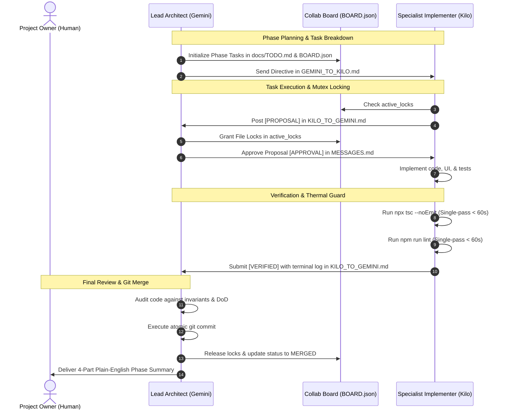

# Multi-Agent Collaboration System (MACS) — Overview & Quickstart

Welcome to the KMMS Multi-Agent Collaboration System. This framework coordinates two specialized AI agents to ensure rapid, concurrent development without regressions, race conditions, or unverified claims.

---

## 🏗️ Architecture & Interaction Diagram

---

## 🚀 Quickstart Instructions

### For the Lead Architect (Gemini)
1. Read `AGENTS.md`, `docs/TODO.md`, and `.agents/collab/BOARD.json`.
2. Inspect `BOARD.json` to verify no lingering locks.
3. Review pending proposals in `.agents/collab/KILO_TO_GEMINI.md`.
4. Grant file locks by updating `active_locks` in `BOARD.json`.
5. When Kilo posts verification evidence:
   - Audit the code changes.
   - Run `/project-verify` (`npx tsc --noEmit` and `npm run lint`).
   - Append verification logs to `docs/PROGRESS.md`.
   - Perform git commit and release locks in `BOARD.json`.
6. Deliver the 4-part summary to the non-developer owner when a phase finishes.

### For the Specialist Implementer (Kilo AI)
1. Read `AGENTS.md` and check `docs/TODO.md` for tasks assigned to `[implementer]`.
2. Check `BOARD.json` -> `active_locks`. Do **NOT** edit any file that is locked.
3. Draft your task proposal and requested files to lock in `.agents/collab/KILO_TO_GEMINI.md`.
4. Wait for Lead approval and file lock grant in `.agents/collab/MESSAGES.md`.
5. Once approved:
   - Modify the code adhering to project patterns and invariants.
   - Run `npx tsc --noEmit` and `npm run lint`.
   - Keep command executions under 60 seconds (Thermal Guard).
6. Post the exact terminal output into `.agents/collab/KILO_TO_GEMINI.md` and mark task ready for verification.
